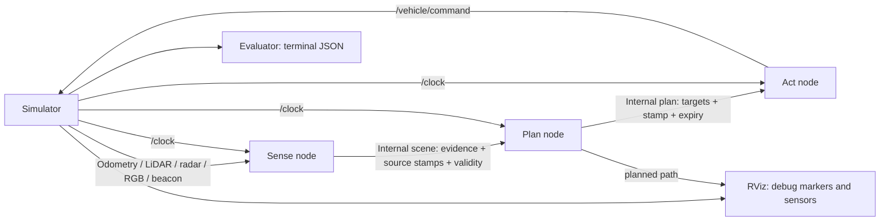
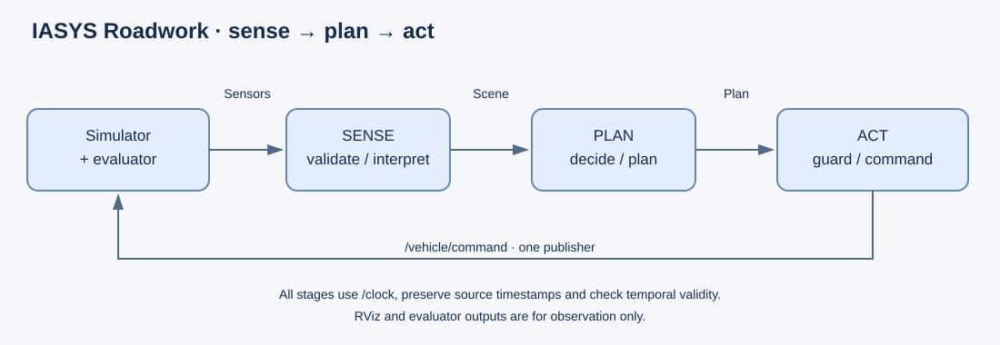

# Required architecture — ROS2 Jazzy

At least **three ROS2 nodes**, in both D1 and D2. The starter launches three
independent C++ executables. Their implementation and the internal ROS message
definitions belong to the students. A single callback invoking three C++ functions
does not satisfy this requirement. Alternative decompositions may add nodes.

Sense subscribes to the external sensor topics, validates messages and derives
perception evidence. Plan subscribes to the internal scene, decides when to enter,
plans the bypass and speed, and exposes its decision state and planned path.
Act subscribes to the plan, executes bounded control targets and is the **only**
publisher of `/vehicle/command`. The reference computes pure-pursuit steering in
Plan and performs command guarding/saturation in Act; students may place tracking
in Act with an additional odometry subscription.

Use internal ROS topics with documented message types, units, frames, QoS, source
timestamps and expiry policy. Do not change `roadwork_interfaces` to conceal an
internal contract in the supplied external messages. Create your own interface
package. Debug markers and evaluator results must never feed the algorithm.
